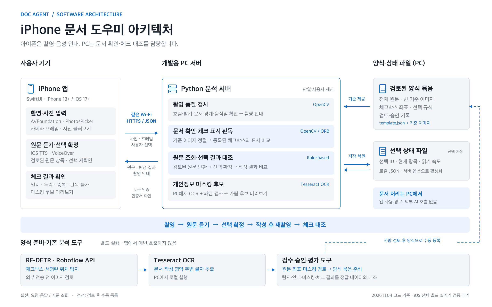

# Doc Agent 개발 과정과 현재 구현 설명

작성 기준: 2026년 11월 4일

Doc Agent는 시각장애인 사용자가 종이 문서의 내용을 듣고 선택한 뒤, 종이에 표시한 결과가 자신의 선택과 일치하는지 확인하도록 돕는 프로젝트다. 현재는 **아이폰 앱에서 촬영·음성 안내·선택 조작을 하고, 같은 Wi-Fi의 PC에서 문서를 분석하는 구조**로 개발했다.

초기에는 체크박스·서명란을 찾아 설명하는 기능부터 시작했다. 이후 원문을 임의로 요약하지 않는 방식으로 안내를 바꾸고, 사용자의 선택과 실제 체크 표시를 비교하는 기능을 추가했다. 이 문서는 그 과정과 기술 선택 이유, 확인한 결과를 정리한다. 이슈나 커밋 단위가 아니라 기능이 발전한 순서로 설명한다.

현재 지원 양식은 합성 동의서 데모다. 아이폰 앱 코드는 작성했지만 **iOS 앱 전체 빌드와 실제 아이폰 검증은 아직 남아 있다.**

## 1. 문서에서 작성 영역을 찾는 기능부터 시작했다

처음 필요한 기능은 체크박스와 서명란이 어디에 있는지 알아내는 것이었다. 팀원이 국내 문서의 작성 영역을 수작업으로 라벨링하고 RF-DETR 기반 탐지 모델을 학습했다. 일반적인 텍스트 입력용 사각형은 제외하고, 실제 선택 기능을 하는 영역을 체크박스로 구분했다.

초기 데이터는 74장이었고 서명란 미탐을 보완하기 위해 106장으로 확대했다. 팀원에게 공유받은 mAP@50은 초기 약 79%, 보강 후 약 81~82%였다. 이는 **팀원의 모델 개발 보고 수치**이며, 이후 코드 연동 작업에서 다시 측정한 값은 아니다. 테스트 구성이 달라 동일한 시험에서 성능이 그만큼 개선됐다고 단정할 수도 없다.

이미 학습한 모델이 있었으므로 이를 Roboflow API로 호출하도록 연결했다. 응답의 클래스·신뢰도·박스 좌표를 프로젝트 내부 형식으로 바꾸고, 픽셀 좌표를 문서의 mm 좌표로 변환했다. 후속 OCR과 위치 처리가 같은 좌표 기준을 사용하도록 하기 위해서였다.

이 단계에서 할 수 있는 일은 **체크박스의 위치를 찾는 것**이다. 그 칸에 체크가 되어 있는지, 사용자가 의도한 항목인지 판단하는 일은 별도 기능이 필요했다.

## 2. OCR로 작성 영역과 주변 문구를 연결했다

박스 위치만으로는 해당 항목이 개인정보 동의인지, 서명란인지 설명할 수 없었다. 그래서 탐지 영역 주변을 잘라내는 Crop 처리와 한국어·영어 OCR을 연결했다.

OCR은 **Tesseract**를 사용했다. PC에서 실행할 수 있고 인식한 단어의 좌표와 신뢰도를 제공해, 글자와 작성 영역을 연결하기에 적합했다. 별도의 OCR 모델을 학습한 것은 아니다.

잘라낸 이미지 안의 단어 좌표는 전체 문서 좌표로 복원했다. 체크박스 옆의 선택지와 서명란 주변 문구를 연결하되, 글자가 없거나 어느 항목의 문구인지 모호하면 임의로 채우지 않고 검토 필요 상태로 남겼다.

공유된 원본과 촬영본을 정리해 총 299페이지에서 Roboflow 탐지와 Tesseract OCR 연동을 실행했다.

| 입력 | 페이지 수 | 탐지 후보가 나온 페이지 |
|---|---:|---:|
| 원본 | 162 | 119 |
| 촬영본 | 137 | 118 |
| 합계 | 299 | 237 |

이 결과는 실제 파일을 처리할 수 있는지 확인한 기록이다. 원본을 출력해 찍은 사진도 포함되어 있어 서로 다른 양식 299종을 의미하지 않는다. 정답 박스와 정답 텍스트가 없었으므로 237/299를 정확도로 해석하지 않았다. 후보가 없는 페이지에는 탐지 대상 자체가 없는 안내문·법령 본문도 포함됐다.

## 3. 설명을 생성하는 방향에서 검토된 원문을 읽는 방향으로 바꿨다

초기 구상에는 탐지와 OCR 결과를 LLM으로 해석해 작성 방법을 설명하는 단계가 있었다. 그러나 문서의 조건이나 예외를 임의로 요약하면 사용자의 선택에 영향을 줄 수 있다는 피드백을 받았다.

이에 지원 문서를 제한하고, 사람이 검토한 문구를 찾아 제공하는 Rule 기반 안내를 먼저 구현했다. 이후 “안내문도 원문 그대로 읽어야 한다”는 요구에 맞춰, 검색에 쓰는 주변 문구와 실제 낭독할 원문을 분리했다.

현재 읽기 기능은 **원본과 대조해 등록한 페이지·항목 원문을 그대로 반환**한다. OCR에서 나온 문자열을 확인 없이 곧바로 읽는 방식이 아니다. 검토가 끝나지 않았거나 지원 양식을 확인하지 못하면 해당 문서의 원문 안내를 제공하지 않는다.

기존 분석 도구에는 문서 ID와 OCR 키워드를 이용한 안내 검색이 있다. 현재 홈·아이폰 경로에서는 실행 시 지정한 양식의 기준 이미지와 촬영본이 일치하는지 확인한 뒤, 그 양식의 원문을 조회한다. 임의의 문서를 여러 양식 중에서 자유롭게 식별하는 기능과는 구분된다.

양식마다 달라지는 원문, 빈 기준 이미지, 체크박스 좌표, 선택 가능한 개수는 **양식 묶음 파일**로 분리했다. 새 문서를 지원하려면 이 정보를 준비하고 사람이 검토·승인해야 한다. 현재 앱의 안내 흐름에는 생성형 LLM이나 벡터 RAG가 연결되어 있지 않다.

## 4. 사용자의 선택과 실제 체크 표시를 비교하도록 확장했다

하드웨어 없이 집에서 문서를 읽고 확인하는 방향으로 범위를 조정하면서, 지원 문서도 동의서 중심으로 바꿨다. 실제 동의서 종류는 아직 정하지 않아 공통 기능을 합성 양식으로 먼저 구현했다.

핵심은 다음 두 정보를 따로 관리하는 것이다.

| 정보 | 의미 | 얻는 방법 |
|---|---|---|
| 확정한 선택 | 사용자가 어떤 항목을 선택하려 했는지 | 앱에서 선택 → 재확인 → 확정 |
| 관측한 표시 | 종이의 어느 칸에 실제 표시가 있는지 | 작성 후 새로 촬영한 이미지 분석 |

예를 들어 사용자가 앱에서 ‘동의하지 않음’을 확정했더라도, 그것만으로 종이 작성이 끝났다고 판단하지 않는다. 작성 후 사진에서 실제 표시를 확인한 뒤 두 결과를 비교한다.

체크 판독에는 **OpenCV와 빈 기준 이미지 비교**를 사용했다. 지원 양식과 좌표를 미리 알고 있으므로, 현재 범위에서는 새 체크 분류 모델을 학습하지 않고도 비교 기능을 구현할 수 있었다.

먼저 ORB 특징점으로 기준 이미지와 촬영본의 위치·기울기를 맞춘다. 페이지가 잘렸는지, 인쇄 내용이 기준과 맞는지도 확인한다. 정렬된 이미지에서는 체크박스 테두리의 영향을 줄이고, 내부에 새로 생긴 흔적을 기준 이미지와 비교한다. 표시 여부가 모호하면 미체크로 간주하지 않고 판독 불가로 남긴다.

이 방식은 등록된 양식과 비교하는 방식이므로 모든 문서와 필기 형태에 대한 범용 인식 성능을 확보한 것은 아니다.

| 앱에서 확정한 선택 | 촬영본의 표시 | 안내 결과 |
|---|---|---|
| 동의하지 않음 | 동의하지 않음에 표시 | 선택과 표시 일치 |
| 동의하지 않음 | 동의함에 표시 | 선택과 표시 불일치 |
| 동의하지 않음 | 표시 없음 | 미표시 안내 |
| 동의하지 않음 | 두 칸 모두 표시 | 하나만 선택하는 항목이면 중복 안내 |
| 동의하지 않음 | 사진이 흐려 판단하기 어려움 | 판정 보류·재촬영 요청 |

선택을 바꾸거나 새 사진을 받으면 이전 완료 판정을 지운다. 이전 사진의 성공 결과가 남아 새 작업도 완료된 것처럼 보이는 상황을 막기 위해서다. 문서 종류는 확인되지만 체크만 희미한 경우에는 원문 읽기는 허용하고 체크 완료 판정은 보류한다.

## 5. 촬영 안내와 마스킹 후보를 처리 흐름에 추가했다

촬영 품질이 나쁘면 이후 분석도 불안정해지므로, 연속 프레임의 흐림·밝기·문서 경계·기울기·움직임을 확인하도록 했다. 안정된 프레임이 이어지면 촬영 준비 상태를 알리고, 같은 경고를 지나치게 반복하지 않도록 안내 간격을 조절했다.

이 기능은 매 프레임을 생성형 AI에 보내 장면을 설명하는 방식이 아니다. 기존 영상 처리와 품질 기준을 이용해 촬영 상태를 판단한다.

개인정보 처리는 별도 기능으로 구성했다. Tesseract가 찾은 글자 좌표와 개인정보 패턴 규칙을 연결해, 전화번호·주민번호 등 탐지 가능한 정보의 가림 후보를 만든다. 사용자는 가린 미리보기를 확인할 수 있다.

자동 후보는 완전한 마스킹 승인이 아니다. 이름·주소·필기·OCR 누락처럼 놓칠 수 있는 정보가 있고, 후보가 없다고 개인정보가 없다고 결론 내리지 않는다. 기존의 사람이 직접 영역을 검토하고 승인하는 마스킹 도구도 유지했다.

## 6. PC 웹 기능을 재사용해 iPhone 앱을 만들었다

처음에는 PC의 로컬 웹 화면에서 촬영·원문 읽기·선택·체크 대조를 연결했다. 이후 아이폰에서 사용할 수 있도록 **SwiftUI 네이티브 앱**을 추가했다. 웹 화면을 앱 안에 띄우는 WebView 방식은 사용하지 않았다.

지원 범위는 iPhone 13 이상·iOS 17 이상으로 정했다. iOS의 카메라, 사진 선택, 음성 합성, VoiceOver를 연결하기 위해 SwiftUI와 Apple 기본 프레임워크를 사용했다.

문서 분석은 아이폰에서 전부 다시 구현하지 않고 PC의 Python 기능을 재사용했다. 이미 구현한 OpenCV·Tesseract·원문 조회·선택 비교를 유지하면서 모바일 입력과 안내를 추가하기 위한 선택이었다. 대신 현재 시연에는 같은 Wi-Fi의 PC 서버가 필요하다.

| 실행 위치 | 담당 기능 |
|---|---|
| iPhone 앱 | 카메라·사진 입력, 선택 조작, 원문·결과 화면, iOS TTS 음성 출력 |
| 개발용 PC | 촬영 품질 확인, 양식 정렬, 체크 판독, 선택 대조, 마스킹 후보 생성 |
| PC의 파일 | 검토된 양식 묶음, 선택적으로 저장하는 이어하기 상태 |

앱과 PC는 HTTPS로 사진과 JSON을 주고받는다. PC가 생성한 연결 파일에 서버 주소·인증서 지문·접속 토큰이 들어가고, 앱은 지정한 인증서가 맞는지 확인한다. 접속 토큰은 서버를 다시 실행할 때 바뀐다. 모바일 서버에서 브라우저용 페이지를 통해 토큰을 가져가는 경로도 차단했다.

PC는 읽을 원문과 안내 문장을 텍스트로 반환한다. **음성은 아이폰의 AVSpeechSynthesizer에서 재생**하며 읽기 정지·속도 조절을 제공한다. VoiceOver용 화면 문구와 상태 안내도 코드에 반영했다. 실제 기기에서의 접근성 사용성은 아직 검증하지 않았다.

네트워크 오류나 앱의 백그라운드 전환 시에는 앱의 결과와 연결을 초기화한다. 처리가 끝나지 않은 요청이나 오래된 결과를 계속 표시하지 않도록 작업 순서와 응답 적용 조건을 관리한다.

## 개발하면서 확인하고 바꾼 부분

| 문제 | 확인한 내용과 대응 |
|---|---|
| 문서 안의 큰 표를 종이 테두리로 오인 | 제목·하단 서명란이 잘리는 사례가 있었다. A4 비율과 바깥 여백을 확인한 원본은 전체 페이지를 유지하도록 보완했다. |
| OCR 전처리가 항상 유리하지 않음 | 전입신고서의 수동 Crop에서는 키워드 포함이 13/17에서 16/17로 늘었지만, 별도 자동 Crop 비교에서는 기본 설정의 11/15가 다른 설정에서 7/15로 줄었다. 기본값은 기존 PSM11·전처리 없음으로 유지하고 표 선 제거는 선택 옵션으로 남겼다. |
| 로컬 분석이 불필요한 대화 초기화에 걸림 | 탐지·OCR만 수행하는 분석과 대화 세션 생성을 분리했다. 이미지 분석이 관계없는 LLM 전송 검사 때문에 중단되지 않도록 했다. |
| test 분할을 미학습 문서로 오해할 수 있음 | 같은 원본의 다른 페이지나 촬영본이 학습·시험에 나뉠 수 있어 원본과 버전별 이력을 함께 확인했다. 개발에 사용한 자료와 최종 평가 촬영본도 구분하기로 했다. |
| 체크 여부가 불확실한데 완료로 안내할 위험 | 사용자 선택과 관측 결과를 분리하고, 판독 불가 상태와 이전 판정 초기화를 추가했다. |

OCR 비교의 17개와 15개는 Crop 방식과 키워드 구성이 다른 별도 실험이다. 이 수치는 문자 인식 정확도나 최종 안내 정확도가 아니라 지정한 키워드가 결과에 포함됐는지 확인한 값이다.

## 지금까지 확인한 결과

아래는 직전 구현·검증 기록 기준이다. 이 설명 문서를 작성하면서 테스트를 새로 실행한 것은 아니다.

| 검증 항목 | 결과 | 의미 |
|---|---|---|
| Python 전체 회귀 테스트 | 1,836개 통과 | 기존 기능을 포함한 처리 규칙·오류·인증 동작 검증 |
| Swift 연결 설정·응답 계약 검사 | 16건 통과 | 연결 파일, 지원 기종, Python 응답 해석 확인 |
| Swift 공통 통신 모듈 | macOS 빌드 성공 | PC에서 통신 코드 실행 가능 확인 |
| Swift ↔ Python 실제 HTTPS 연결 | 합성 문서 흐름 통과 | 원문 읽기, 선택 확정, 재촬영, 일치·중복·흐림 처리, 초기화 확인 |
| 잘못된 인증서 지문·토큰 | 연결 차단 확인 | 다른 인증 정보로 접근하지 못하는지 확인 |
| iOS 앱 전체 빌드·설치·촬영 | 미검증 | 현재 Mac에 Xcode와 iOS SDK가 없어 수행하지 못함 |

합성 문서 5건의 체크 대조 평가 결과는 다음과 같다.

| 지표 | 결과 |
|---|---:|
| 실제 완료가 아닌데 완료로 안내한 사례 | 0/4 |
| 반대 표시·누락·중복 문제를 발견한 사례 | 3/3 |
| 정상 작성 결과를 완료로 확인한 사례 | 1/1 |
| 판독 불가로 처리한 사례 | 1/5 |

합성 사례는 정상·반대 선택지·미표시·중복 표시·흐린 사진으로 구성했다. 개발 중 만든 소규모 사례이므로 **실제 동의서 정확도나 시각장애인 사용자의 독립 작성 성공률로 제시할 수 없다.** 자동 테스트 통과 수도 모델 인식 정확도와는 별개다.

## 현재 범위와 남은 작업

현재 구현한 범위는 **등록된 문서의 원문을 듣고, 선택을 확정하고, 작성 후 체크 표시를 대조하는 기능**이다. 손을 정확한 작성 위치로 유도하거나 사용자를 대신해 서명하는 기능은 포함하지 않는다. 서명 진위·법적 유효성도 판정하지 않는다.

아이폰에서 실제 시연하려면 Xcode로 앱을 빌드·서명하고 설치한 뒤, 카메라·로컬 네트워크·VoiceOver·읽기 속도를 확인해야 한다. Swift 공통 모듈이 PC에서 동작한 사실만으로 iOS 앱 전체가 검증됐다고 볼 수는 없다.

실제 문서 적용을 위해 남은 작업은 다음과 같다.

1. **실제 동의서 1종 선정:** 원문, 빈 기준 이미지, 체크박스 좌표, 선택 규칙을 준비하고 검토·승인한다.
2. **실제 촬영 정답셋 구축:** 정상·반대 표시·누락·중복·흐림·부분 잘림을 포함하고, 개발에 쓰지 않은 촬영본으로 평가한다.
3. **아이폰 실기기 검증:** 앱 설치부터 촬영·원문 듣기·선택·재촬영·결과 확인까지 연결해 실행한다.
4. **정확도와 사용성 평가:** 오완료율·문제 발견율·판독 불가율을 측정하고 실제 사용자에게 안내가 이해되는지 확인한다.
5. **운영 방식 결정:** 현재 단일 사용자용 PC 서버를 유지할지, 이후 다중 사용자 서버나 기기 내 처리로 확장할지 결정한다.

현재 앱의 사진은 **마스킹 전 상태로 지정한 PC에 전송**된다. 마스킹 후보는 PC에서 생성한다. 앱은 연결 정보와 사진을 영구 저장하지 않고 PC도 촬영 원본을 앱 저장 파일에 쓰지 않지만, OCR 실행 과정의 OS 임시 파일과 실행 중 메모리는 사용할 수 있다. 선택 상태의 파일 저장은 서버 옵션을 켠 경우에만 수행한다. 강제 종료·네트워크 단절 때 PC 메모리에 남은 사진은 서버 종료나 다음 초기화까지 유지될 수 있다.

## 관련 자료

- [현재 아키텍처와 코드 위치](software-architecture.md)
- [아이폰 설치·연결·시연 절차](../ios/README.md)
- [홈 문서 도우미의 양식 등록·평가 방법](home-document-assistant.md)
- [초기 탐지·OCR 연동과 실제 문서 검증](ocr-integration.md)
- [OCR 개선 실험과 원문 낭독 변경](performance-and-verbatim.md)
