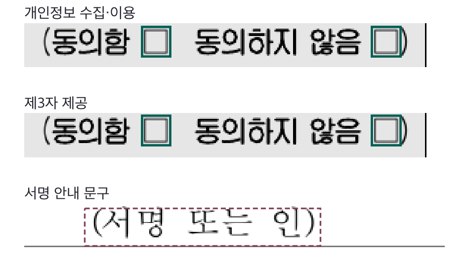

# 시각장애인을 위한 문서 도우미 개발 회고

2026년 11월 21일 · 시연 문서 **직업훈련생계비 대부 신청서 5쪽 「개인정보의 수집·이용·제공 동의서」** · [구현 기준 커밋](https://github.com/SangSangGround/doc-agent/commit/657de513b4cbc28616195102740fe383183a5d1c) · [시연에 사용한 2024년 서식의 출처](https://www.moel.go.kr/info/lawinfo/instruction/view.do?bbs_seq=20231202307)

문서의 글자를 읽어주는 기능을 만들다 보니, 사용자가 그 기능에 도달하기 전에 풀어야 할 문제가 있었다. 화면을 보며 종이의 네 모서리를 맞추고, 작은 글자에 초점을 잡고, 잘 찍혔는지 확인해야 했다. 우리는 촬영 방향을 소리로 안내하고 사용자가 직접 찍은 한 장을 아이폰에서 읽어주는 흐름을 만들었다. 읽고 나서는 “내 정보를 누가 받아?”나 “관련된 실제 사례가 있어?”처럼 이어서 물을 수 있게 했다.

## 1. 문서 분석이 실패한 이유를 입력 사진에서 찾았다

초기에는 체크박스와 서명란을 찾아 주변 문구와 연결하는 데 집중했다. 원본 162쪽과 촬영본 137쪽을 처리해 총 299쪽 중 237쪽에서 탐지 후보가 나왔다. 그런데 문서 안의 큰 표를 종이 외곽으로 잘못 잡아 제목과 서명란을 잘라낸 사례가 있었다. 뒤에서 탐지 모델을 다시 돌려도 이미 잘린 영역은 복구할 수 없었다. 이때의 237쪽은 후보를 반환한 페이지 수이며, 정답 위치와 대조한 페이지 수는 아니다. [초기 실험 회고](https://github.com/SangSangGround/doc-agent/blob/657de513b4cbc28616195102740fe383183a5d1c/docs/project-retrospective-20261030.md#3-실제-문서를-넣으면서-입력-처리의-문제를-발견했다)

노트북 웹캠에서도 비슷한 문제가 드러났다. 실제 실패 사진 한 장에서 앱은 **40줄 중 34줄을 ‘인식 불확실’로 분류하고도** 문서를 읽었다고 안내했다. 배경을 종이로 고른 문제와 원근 보정 과정에서 글자가 손상되는 문제를 확인했다. 그래서 맥에서는 촬영 원본에 Apple Vision 한국어 OCR을 적용하고, 종이 밖에서 읽힌 글자만 좌표로 걸러냈다. 성공 안내에는 신뢰할 만한 글자의 비율도 반영했다.

수정 후 같은 사진에서 사람이 **제목, 보유 기간, 동의 거부, 참여 제한, 14세 미만 관련 문구** 다섯 가지를 확인했다. 이 사진에서 34/40은 앱이 불확실하다고 표시한 줄의 비율이다. 수정 후 확인한 다섯 문구와 직접 비교할 전체 문자 정답률은 측정하지 않았다. [웹캠 OCR 실패와 수정 기록](https://github.com/SangSangGround/doc-agent/blob/657de513b4cbc28616195102740fe383183a5d1c/docs/home-document-assistant.md#ocr-실패-수정-2026-11-13)

## 2. 비프음으로 움직임의 결과를 알려주고, 촬영 시점은 사용자가 정하게 했다

직접 써본 피드백은 “움직여도 나아지는지 모르겠어”였다. 종이가 잘렸다는 음성 문구를 반복해도 사용자는 방금 움직인 방향이 맞는지 알기 어려웠다. 안내 음성과 비프음이 겹치면 박자 변화도 듣기 어려웠다.

아이폰에서는 **방향은 말로, 움직인 결과는 박자로** 전달하도록 바꿨다. “휴대폰을 왼쪽으로 옮겨 주세요”라는 말을 듣고 움직여 종이가 더 들어오면, 비프음 간격이 짧아지고 음높이가 올라간다. 가만히 있으면 박자를 유지한다. 네 모서리가 안정적으로 들어오면 긴 확인음이 한 번 난다. 비프 간격 **0.94~0.27초**, 음높이 **5단계**, 안내 음성 중 비프 재생 음량 **0.32 → 0.10**은 앱에 설정한 값이다. [비프음과 방향 판단](https://github.com/SangSangGround/doc-agent/blob/657de513b4cbc28616195102740fe383183a5d1c/ios/DocAgentCore/Sources/DocAgentCore/FramingGuidance.swift) · [음향 구현](https://github.com/SangSangGround/doc-agent/blob/657de513b4cbc28616195102740fe383183a5d1c/ios/DocAgentApp/CaptureSound.swift)

자동 촬영을 없애고 **비프음 안내 → 볼륨 위로 초점 맞추기 → 준비 안내 → 볼륨 아래로 촬영**하는 순서를 만들었다. 물리 버튼은 iOS 17.2부터 쓸 수 있고 화면에도 같은 버튼이 있다. 촬영 후에는 카메라가 지원하는 최대 사진 해상도로 받은 정지 사진을 OCR에 전달한다. 화면 조작을 줄이기 위해 원문 듣기와 질문은 사진을 읽은 뒤에 보여준다. [아이폰 촬영·읽기 흐름](https://github.com/SangSangGround/doc-agent/blob/657de513b4cbc28616195102740fe383183a5d1c/ios/README.md)

| 검증한 문제 | 관찰한 결과 | 결정에 준 근거 |
|---|---|---|
| 노트북에서 촬영 준비 신호만 믿어도 될까? | 등록 양식 한 장으로 만든 정상·기울임·잘림·흐림·흰 덮임 5건에서, 문제 입력 **1/4**이 준비 판정을 통과했다. 같은 입력을 강제로 촬영해 기준 양식과 맞춰 보니 문제 입력 통과는 **0/4**였다. | 준비 신호와 촬영 후 판독 가능성을 따로 검사한다. 흰 덮임은 인쇄 내용을 가린 합성이며 실제 빛 반사는 별도 평가 대상이다. |
| 왼쪽이 화면 밖인데 왜 종이 전체로 판정했을까? | 사용자가 보낸 캡처의 카메라 영역을 이전 코드에 넣자, 화면 왼쪽 끝에서 폭의 **약 0.69%** 안쪽에 종이 변이 있다고 추정했다. 수정 후에는 같은 입력에서 **‘왼쪽 잘림’, 초점 잠금**으로 바뀌었다. | 사각형 후보 주변에 실제 종이 바깥 여백이 있는지 밝기와 색으로 검사한다. 종이가 화면 끝까지 이어지면 잘린 방향을 안내한다. |

수정한 아이폰 판정 코드를 맥에서 실행해 제보 캡처, 방향을 바꾼 파생 이미지, 정상·빈 종이 등 대조 입력 **11건 모두** 예상한 상태가 나오는 것을 확인했다. 11건에는 같은 캡처의 변형이 들어 있다. 실제 사용 중 잘못된 촬영 허용률과 재촬영 횟수는 다음 현장 평가에서 측정한다. [노트북 평가 방법](https://github.com/SangSangGround/doc-agent/blob/657de513b4cbc28616195102740fe383183a5d1c/scripts/evaluate_laptop_capture.py) · [종이 바깥 여백을 검사하는 코드](https://github.com/SangSangGround/doc-agent/blob/657de513b4cbc28616195102740fe383183a5d1c/ios/DocAgentCore/Sources/DocAgentCore/PreviewDocumentDetector.swift)

## 3. OCR이 읽은 금액을 AI가 확인할 때, 원래 숫자를 보존했다

또 다른 피드백은 “제대로 읽었는데도 불확실하다고 나온다”였다. 경고를 일괄 해제하면 틀린 금액이나 동의 조건까지 확정적으로 읽을 수 있었다. 반대로 모델이 문장을 다시 쓰게 하면 어떤 글자가 실제 사진에 있었는지 알기 어려워졌다.

우리는 먼저 Vision이 원본 사진에서 읽은 문장을 들려주고, 아이폰 안의 **Qwen3.5-0.8B**가 해당 문구를 잘라낸 사진과 대조하도록 했다. 낮은 신뢰도의 줄은 **다른 해상도에서 다시 읽은 OCR 문구가 같고, Qwen도 사진과 일치한다고 판단할 때** 경고를 해제한다. 사용자가 듣는 글자와 숫자는 처음 읽은 원문을 유지한다. 글자가 검출되지 않은 면은 사진에서 필기 흔적이 거의 없고 모델도 빈 종이라고 판단할 때 반대쪽을 확인하도록 안내한다.

테스트에서는 첫 OCR이 **12,000원**, 두 번째가 **12,800원**이면 모델이 일치한다고 답해도 ‘인식 불확실’이 유지됐다. 백지·인쇄 문구·노출 문제·금액 불일치를 다룬 사진 재검토 테스트 **4/4**가 맥에서 통과했다. 기존 노트북 시연은 Ollama의 4B 모델을 썼고, 서버를 따로 띄우지 않는 아이폰 시연에는 0.8B 모델과 이미지 처리용 가중치를 함께 넣었다. 두 파일은 합계 약 **738MB**다. [사진 재검토 테스트](https://github.com/SangSangGround/doc-agent/blob/657de513b4cbc28616195102740fe383183a5d1c/ios/DocAgentCore/Tests/DocAgentCoreTests/PhotoReviewTests.swift) · [모델 준비 방식](https://github.com/SangSangGround/doc-agent/blob/657de513b4cbc28616195102740fe383183a5d1c/ios/prepare_review_model.py)

## 4. “그럼 제공받은 곳은?”이라는 후속 질문에도 근거를 이어갔다

“내 정보를 누가 받아?”의 답은 촬영한 문서에 있다. “대출 상담을 사칭한 실제 사례가 있어?”의 답은 다른 자료에서 가져와야 한다. 두 질문에 같은 방식으로 답하면 다른 사건에서 일어난 일이 내 동의서에도 적혀 있다고 오해할 수 있다.

초기 노트북 실험에서 가상 원문 4개에 대해 질문 8개를 던졌다. 모델은 수수료 질문 다음의 **“그 돈을 돌려받을 수 있어요?”**를 환불 문구에 연결하지 못했다. 직전 질문과 답의 원문 근거를 함께 전달하자 같은 질문 세트에서 기대한 결과가 **7/8 → 8/8**로 바뀌었다. 수정 후 근거가 있는 5건에 답하고, 보류해야 할 3건을 보류했다. 모델을 미리 불러온 맥에서 질문당 **1.21~1.87초**가 걸렸다. 이는 개선에 사용한 개발 질문의 처리 시간이다. [노트북 실험 기록](https://github.com/SangSangGround/doc-agent/blob/657de513b4cbc28616195102740fe383183a5d1c/docs/home-document-assistant.md) · [질문과 기대 결과](https://github.com/SangSangGround/doc-agent/blob/657de513b4cbc28616195102740fe383183a5d1c/scripts/evaluate_local_questions.py)

아이폰에서는 촬영한 **한 면의 OCR 원문**, 앱에 담은 **판례 4건**, **용어 설명 7건**에서 관련 근거를 찾는 로컬 검색 방식(RAG)을 적용했다. 어느 항목을 묻는지 분명하면 해당 원문을 읽고, 후보가 여럿이면 Qwen이 근거를 선택하도록 했다. 앱은 답을 읽기 전에 ‘촬영한 원문’, ‘다른 사건의 사례’, ‘용어 설명’ 중 출처를 알려준다. 근거가 부족하면 확인할 수 없다고 안내한다. [앱에 넣은 근거 자료](https://github.com/SangSangGround/doc-agent/blob/657de513b4cbc28616195102740fe383183a5d1c/ios/DocAgentCore/Sources/DocAgentCore/consent-library.json)

발표에서 재현하기 좋은 흐름은 **“내 정보는 누구에게 제공돼?” → “대출 상담을 사칭한 실제 사례가 있어?” → “그럼 내 동의서에서 거부하면 어떻게 돼?”**다. 2024년 공개 서식 5쪽 이미지 한 장으로 제공받는 기관을 읽고, 관련 사건 **2016도11138**을 찾고, 다시 촬영한 원문의 거부 조건을 읽는 흐름을 맥에서 검증했다. 공단과 제공받는 기관의 보유 기간을 구분하는 후속 질문을 포함해 동의서 관련 테스트 **5/5**가 통과했다. [동의서 질의응답 테스트](https://github.com/SangSangGround/doc-agent/blob/657de513b4cbc28616195102740fe383183a5d1c/ios/DocAgentCore/Tests/DocAgentCoreTests/ConsentConversationTests.swift) · [사례 원문](https://www.law.go.kr/LSW/precInfoP.do?precSeq=183967)

## 5. 빈 ‘동의함’ 칸을 체크됐다고 읽는 오류를 확인했다

체크박스 판독을 Qwen에 바로 맡길 수 있는지 시험했다. 시연 동의서 **한 장의 첫 번째 선택 행**에 무표시, 왼쪽 체크, 오른쪽 체크, 양쪽 체크, 옅은 체크, X 표시를 넣어 이미지 6개를 만들었다. 각 이미지에서 좌우 두 칸을 물어 **빈칸 6회, 표시된 칸 6회**를 판정했다. 맥에서 아이폰에 넣은 것과 같은 모델·이미지 처리 설정을 사용했다.

| 판독 방법 | 실제 빈칸 6회 | 실제 표시된 칸 6회 |
|---|---|---|
| Qwen에 문서 전체를 주고 대상 행과 좌우를 지정 | 6회 모두 판독 보류 | 6회 모두 판독 보류 |
| 정확한 칸 위치를 미리 주고 칸만 확대해 Qwen에 제공 | **6회 모두 ‘표시 있음’으로 오판** | 5회 감지, 1회 보류 |
| 기존 영상 처리 코드로 빈 양식과 비교 | 6회 모두 ‘빈칸’으로 판독 | 6회 모두 판독 보류 |

확대본에서는 ‘동의함’의 빈칸 3회와 ‘동의하지 않음’의 빈칸 3회 모두 잘못 읽었다. 질문 문구와 답 선택지 순서를 바꿔 확대본 6개를 다시 넣자 이번에는 6개 모두 판단을 보류했다. **모델 단독으로 선택 여부를 확정해 낭독하기에는 빈칸 오판이 컸다.** 빈 양식 대조 방식은 이 표본에서 잘못된 동의 안내를 막았지만 실제로 넣은 표시도 모두 보류했다. 손으로 작성한 실물 사진에서 두 오류를 각각 측정한 뒤 판정 기준을 정해야 한다. [앱의 이미지 판정 코드](https://github.com/SangSangGround/doc-agent/blob/657de513b4cbc28616195102740fe383183a5d1c/ios/DocAgentCore/Sources/DocAgentCore/VisualReview.swift) · [비교한 빈 양식 대조 코드](https://github.com/SangSangGround/doc-agent/blob/657de513b4cbc28616195102740fe383183a5d1c/src/docagent/vision/checkbox_review.py)

## 6. 손가락 안내를 위해서는 ‘어디에 쓸지’부터 찾아야 했다

손가락 안내를 맡은 팀원에게 필요한 값은 사용자가 고른 칸의 **현재 카메라 좌표**다. 2024년 시연 서식의 항목은 `동의함 □  동의하지 않음 □` 순서였다. 기존 노트북 코드는 네모 오른쪽의 글자로 항목명을 찾았기 때문에, 첫 네모가 다음 선택지와 연결되거나 마지막 네모가 누락될 수 있었다. [기존 문구 연결 방식](https://github.com/SangSangGround/doc-agent/blob/657de513b4cbc28616195102740fe383183a5d1c/src/docagent/home/reader.py#L71)

맥에서 Apple Vision OCR로 선택 문구가 있는 줄을 찾고, 그 주변에서 OpenCV로 글자 높이와 비슷한 사각 테두리를 골랐다. 첫 줄의 ‘동의함’을 ‘동의항’으로 오독했어도 옆의 ‘동의하지 않음’으로 줄을 찾을 수 있었다. **1,405 × 1,989픽셀 원본 한 장에서 체크칸 4/4**를 찾았다. 칸 하나는 **17 × 18픽셀**, A4 인쇄 시 폭 약 **2.5mm**였다. 하단에서는 **‘(서명 또는 인)’ 문구 한 곳**의 좌표를 얻었다. 실제로 펜을 댈 공간은 시연 인쇄본에서 지정할 필요가 있다.

손가락이 작은 칸을 가릴 수 있어서, 종이가 움직이면 주변 인쇄 글자를 이용해 이미 찾은 칸의 좌표를 옮기는 방법도 시험했다. SIFT로 원본과 변형 이미지의 같은 특징점을 찾고, RANSAC으로 원근 변환을 추정했다. **합성 기울임 이미지 2장 각각에서 네 중심점 모두 정답 위치 1픽셀 이내**에 들어왔다. 이는 같은 원본을 변형한 두 장에서 좌표를 옮긴 결과다. 실제 손이 들어오는 영상에서 목표 추적이 유지되는지, 사용자가 그 칸에 도달해 작성하는지는 아직 검증 전이다.

## 다음 시연에서 기록할 것

이번 버전에서 맥의 Swift 회귀 테스트는 **29/29** 통과했다. 앞서 언급한 사진 재검토 4개와 동의서 질의응답 5개가 여기에 포함된다. 사용자가 아이폰 홈 화면에서 문서 읽기 화면을 연 것은 확인했다. 아이폰에서 문서를 찾아 손으로 작성하기까지의 성공률·소요 시간은 별도의 실사용 평가가 필요하다.

| 과제 | 기록할 값 |
|---|---|
| 화면을 보지 않고 문서 한 장 촬영하기 | 정상·기울임·잘림·흐림·실제 빛 반사별로 잘못된 사진이 준비 판정을 받은 건수 / 문제 사진 수, 촬영까지 걸린 시간, 재촬영 횟수 |
| 금액·기관·조건을 듣고 다시 질문하기 | 정답 원문과 일치한 핵심 항목 수 / 전체 항목 수, 근거 없는 질문에 단정적으로 답한 건수, 첫 음성 답변까지 걸린 시간 |
| 손가락을 선택한 칸으로 옮기고 작성하기 | 손 가림 전후 위치 오차(mm), 목표 칸 도달·작성 성공 수 / 시도 수, 빈칸을 체크로 잘못 읽은 건수 / 빈칸 수, 놓치거나 보류한 표시 수 / 표시된 칸 수 |
