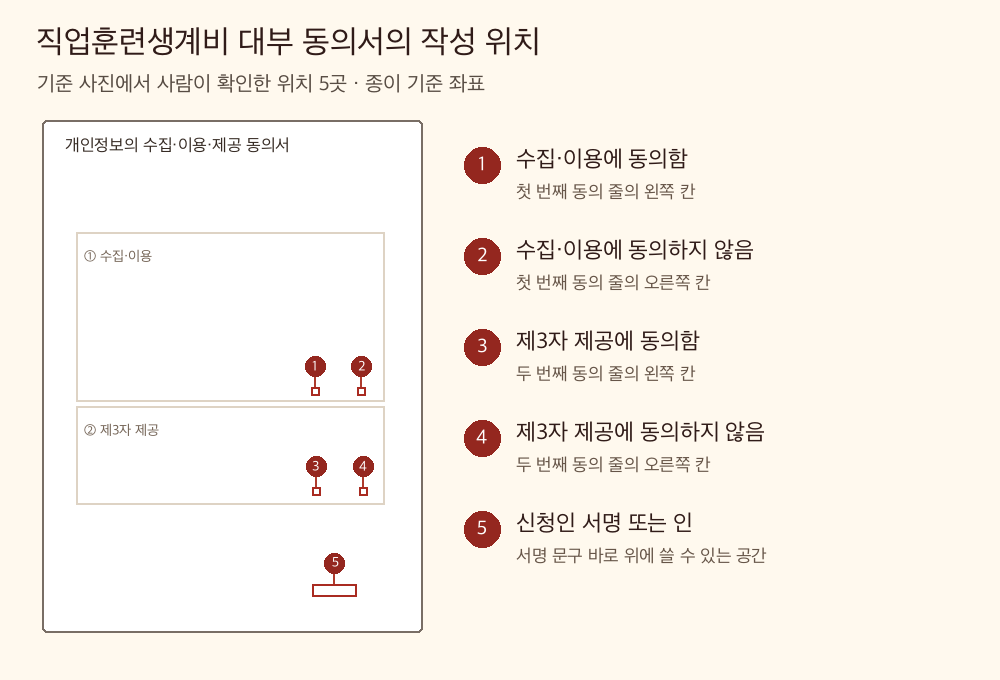

# 문서 도우미 발표자용 시연·검증 정리

2026년 11월 22일 · 직업훈련생계비 대부 신청용 개인정보 동의서 · iPhone 앱

**시연에서 보여줄 변화는 문서를 듣고 난 사람이 종이 위에서 원하는 칸까지 직접 찾아갈 수 있다는 점이다.** 예를 들어 “개인정보 제3자 제공에 동의하지 않음”을 선택하면 앱이 검지를 두 번째 동의 줄의 오른쪽 칸으로 안내한다. 종이에 표시한 뒤 다시 촬영하면 그 사진에서 체크 상태를 읽는다.

발표에 인용할 수 있는 결과는 세 가지다. ① 시연 원본의 인쇄문을 변형 사진으로 평가했을 때 표본 문자 오류율이 **8.27%에서 3.18%**로 낮아졌다. ② 캐시가 허용된 7장에서 목표 중심 **35/35개**가 올바른 작성 영역에 놓였다. ③ 실제 문서 정합에 모의 손끝 궤적을 연결한 시험에서 **도착 35/35회, 다른 칸 오도착 0/140회**였다. 세 수치 모두 한 원본을 이용한 맥 재생 시험이다. 실제 사용자가 손으로 칸을 찾아가는 시간과 성공률은 별도 실기기 시험 항목이다. [케이스별 측정값](validation/writing-demo-2026-11-22.json)

## 시연 문서와 조작 순서

기준은 제공받은 `IMG_2510.heic`에 찍힌 **붙임3 · 별지 제3호서식 · 2024.1.1. 개정 「개인정보의 수집·이용·제공 동의서」**다. 수집·이용과 제3자 제공은 각각 독립된 선택이다. 서명 목표는 ‘서명 또는 인’이 인쇄된 글자 바로 위의 빈 공간이다.



| 7분 시연 | 조작과 설명 |
|---|---|
| 0:00–1:00 | 후면 카메라로 종이 전체를 잡는다. 비프음과 방향을 듣고 **초점 맞추기 → 촬영**을 누른다. 결과로 넘어가 **전체 원문 듣기**를 실행한다. |
| 1:00–2:00 | “내 정보는 누구에게 제공돼?”라고 말한다. 아이폰이 받아쓴 내용을 듣고 확인한다. 시연 문서에서 준비된 답과 출처 줄을 듣는다. 새로운 질문을 라이브로 보여줄 때는 같은 Wi-Fi의 맥과 OpenAI 키를 사전에 확인한다. |
| 2:00–3:00 | **체크·서명 안내**에서 수집·이용과 제3자 제공이 서로 다른 줄임을 들려준다. **개인정보 제3자 제공에 동의하지 않음**을 고른다. |
| 3:00–4:30 | 같은 종이를 비추고 한 손의 검지를 같은 줄의 반대 선택지에 먼저 놓는다. 방향 안내를 따라 옮겨 오른쪽 칸에서 멈춘다. 도착음과 진동을 확인한다. |
| 4:30–5:30 | **다른 칸 선택 → 신청인 서명 또는 인**을 누른다. 문서나 손이 가려지면 도착 안내가 해제되고 다시 찾는 과정을 보여준다. |
| 5:30–6:20 | 종이에 직접 체크하고 손을 치운 뒤 **작성 후 새로 촬영**한다. 다시 **체크·서명 안내**를 열어 바뀐 표시와 옆 칸의 상태를 듣는다. |
| 6:20–7:00 | 다른 서류를 불러와 시연 원문과 다섯 좌표가 따라오지 않는 것을 보여준다. 일반 문서의 사진 분석은 사진 전송을 선택해야 시작한다. |

라이브 촬영을 먼저 시연하는 경우 양식 식별 배지가 나오는지 확인한다. 초점이나 원근이 좋지 않아 일반 경로로 넘어가면 밝은 곳에서 다시 촬영할 수 있다. 준비된 사진으로 흐름을 보여줄 때는 **사진 불러오기**에서 원본을 선택하고, 관객에게 원본 지문이 일치해 저장된 고정 문구를 읽는다고 설명한다. 사진 보관함이 형식을 바꿔 전달하면 일반 촬영과 같은 OCR 확인을 거친다.

## 두 팀의 기능을 어떻게 이었나

| 단계 | 입력과 판단 | 실행 위치 |
|---|---|---|
| 촬영·읽기 | 기존 촬영기가 종이 네 모서리와 초점을 확인한다. 직접 촬영한 고해상도 사진을 Vision으로 읽고 원문을 낭독한다. | 아이폰 |
| 시연 양식 식별 | 등록한 파일과 길이·SHA-256이 모두 일치하면 검수한 인쇄 원문 46줄을 불러온다. 재촬영본은 개정일, 서식 번호, 분산된 본문, 동의·서명 주변 문구와 위치를 확인해 이번 사진으로 좌표를 옮긴다. 확인 근거가 부족하면 일반 OCR 결과를 유지한다. | 아이폰 |
| 일반 문서 작성란 | 사용자가 사진 전송을 선택하면 방향을 바로잡은 JPEG 한 장으로 Gemini가 후보를 제안한다. 맥의 OpenCV가 테두리·빈 공간·옆 칸 겹침을 검사하고 필요하면 한국어 OCR로 인쇄 문구를 대조한다. 아이폰은 응답의 사진 지문과 좌표 범위를 확인한다. | Wi-Fi 맥 중계 + Gemini |
| 손끝 안내 | 팀원 v7.5의 ORB 특징점·Hamming 매칭·RANSAC 정합을 아이폰으로 옮겼다. 현재 사진과 실시간 영상에서 인쇄 영역을 대조하고, Vision이 찾은 검지 끝과 선택한 칸의 위치 차이로 음성·비프음을 정한다. 팀원 노트북의 MediaPipe 손끝 입력은 iOS Vision 검지 랜드마크로 연결했다. | 아이폰 후면 카메라 |
| 체크 확인 | 찍은 사진에서 사각 테두리를 찾고 안쪽의 잉크 비율을 평가한다. 흐릿하거나 테두리가 약하면 확인이 어렵다고 읽는다. 도착은 손끝 위치를 알리는 신호이며, 체크 여부는 촬영본의 픽셀에서 다시 판독한다. | 아이폰 |
| 문서 질문 | 한국어 음성을 아이폰에서 전사하고 사용자가 확인한다. 준비된 시연 질문은 일치한 문서의 해당 원문 줄을 재확인한다. 일반 질문과 후속 질문에는 현재 OCR과 최근 대화를 OpenAI에 제공한다. | 아이폰 + 필요시 Wi-Fi 맥 중계 |

작성 안내를 닫으면 읽던 문서와 대화로 돌아간다. 이어하기 수정본은 잠금·앱 종료·재시동 후 마지막 문서와 선택한 칸을 기기에서 복원한다. 카메라는 사용자가 안내를 다시 시작할 때 켜진다. 새 문서로 교체하거나 명시적으로 지우면 이전 작업을 삭제한다. 일반 문서의 사진은 전송에 동의한 경우에만 작성란 분석에 사용하고, 손끝 영상과 질문 음성은 아이폰에서 처리한다. [아이폰 실행 안내](../ios/README.md)

## 검증 결과와 해석

측정 환경은 Apple M4 맥이다. 아이폰용 Debug 앱을 빌드했고, 같은 정합·도착 판정 코드를 재생 시험에서 실행했다. 이미지 변형, 모의 손끝, 저장된 API 응답은 아래에 따로 표시했다. **p95**는 측정값의 95백분위이고, **CER**는 정답 글자 수로 편집 거리(삽입·삭제·교체)를 나눈 값이다.

| 확인한 질문 | 표본과 결과 | 해석 |
|---|---|---|
| 같은 서식만 캐시를 쓰나? | 원본에서 만든 양성 사진 **7/8** 식별. 다른 문서·개정일 변경·보유기간 변경·머리글 바꿔치기·잘림 등 음성 8장에서 **오적용 0/8** | 조정 후 남겨둔 두 변형 중 그림자·원근 사례는 통과했고, 흐린 원근 사례는 일반 경로로 전환했다. 독립 문서는 음성 표본에 포함됐다. |
| OCR 보정은 실제로 개선됐나? | 사람이 확인한 고정 인쇄문 13줄, 한 장당 307글자 × 8장. 공백·문장부호 제외. 원래 OCR **203/2,456** 오류 → 화면 표시 **78/2,456** 오류. **8.27% → 3.18%**, 5.09%p 감소 | 원본 전체 46줄 중 미리 지정한 줄의 수치다. 캐시가 적용되지 않은 양성 1장도 분모에 포함했다. |
| 중요한 문구가 살아났나? | 최대 10년, 제공 기관, 법 조항, 이중수혜 방지, 제공 항목, 거부 시 신청 조건 등 6개 문구 × 8장. **41/48 → 46/48**개 일치 | 보존 의무·목적 달성 등 조건을 포함하는 문장은 실제 답변에서도 원문 줄까지 확인한다. |
| 재촬영본의 작성란은 어디까지 맞나? | 양식 식별 7장 × 5곳. 체크박스 **28/28**, 서명 공간 **7/7**에서 추정 중심이 해당 정답 영역 안에 있었다. 오차 중앙값 **1.70 px**, p95 **3.35 px**, 최대 **4.20 px** | 사람 주석을 기준 변환으로 옮겨 대조했다. 원본 디코딩본은 2344×3156, 나머지 변형은 1340×1800이다. |
| 촬영한 체크 상태를 다시 읽나? | 실제 빈 사진의 네 칸에 한 종류의 체크 획을 그려 16가지 조합 재생. **표시 32/32**, **빈칸 32/32**, 보류 0/64 | 빈 원본 하나와 합성 획 시험이다. 엷은 연필, 동그라미, 실제 사용자의 다양한 필체는 추가 표본이 필요하다. |
| 카메라를 움직여도 표적이 따라가나? | 등록 참조와 정면·원근·90° 회전·부분 잘림·가림·조도 변형 등 8장 **8/8** 정합. 반전·백지·비슷한 머리글·다른 문서 등 **7/7** 거부. 720×960 영상의 위치 40점 오차 중앙값 **0.50 px**, p95 **1.01 px** | 이 시험은 문서를 한 번 읽은 뒤의 실시간 위치 추적을 평가한다. 앞의 양식 캐시 식별 시험과 입력 및 분모가 다르다. |
| 선택한 칸에서만 도착하나? | 7가지 카메라 조건 × 다섯 위치. 실제 OpenCV에 정답 검지 궤적을 주입해 **35/35** 도착. 다른 네 칸에 대면 **0/140** 오도착. 손 소실 **0/35**, 문서 소실 **0/35** 오도착. 손 복귀 후 **35/35** 재도착 | 초당 10개 표본에서 진입 후 안내까지 **700ms**. 앱의 **650ms** 머무름 조건과 표본 간격이 반영됐다. |
| 준비된 질문이 일반 질문을 가로채나? | 등록 문서의 준비된 표현 **4/4**에서 근거 줄을 포함한 응답. 후속·근거 없음·방금 한 체크·복합 질문 **4/4**는 저장 답변을 사용하지 않았다. | 분기와 근거 확인 시험이다. 이 실행에서 외부 GPT 답변 품질과 사람 음성 전사율은 측정하지 않았다. |

### 캐시가 절약한 시간

| 맥에서 잰 구간 | 측정값 | 포함 범위 |
|---|---:|---|
| 제출한 동일 HEIC 10회 | 지문 확인 및 고정 원문 조회 중앙값 **0.51ms**, p95 **0.66ms** | 파일을 메모리로 읽은 이후부터 측정 |
| 새로 촬영한 경우를 모사한 양성 사진 8장 | OCR 중앙값 **798ms**, OCR과 양식·인쇄문 대조 전체 중앙값 **946ms** | 재촬영본은 OCR을 실행한다. 보정은 원문 정확도를 높이는 데 쓰인다. |
| 일반 문서 4장의 작성란 후보 정밀화 | 최초 로컬 처리 중앙값 **785.45ms** → 동일 JPEG 재요청 **1.85ms** | 팀원 저장 Gemini 응답 재생. 각 문서 최초·재요청 각 1회. 네트워크와 아이폰 사진 준비 시간 제외 |
| 작성 중 실시간 정합 | 맥에서 15개 독립 프레임 전체 중앙값 **28.68ms**, p95 **95.34ms** | 다른 종이를 거부하는 프레임 포함. 손끝 검출·음성 출력 제외 |
| 준비된 네 질문의 근거 조회 | 맥 120회 중앙값 **0.12ms**, p95 **0.36ms** | 전사·낭독·네트워크 시간 제외 |

팀원이 저장한 Gemini 요청 로그 4건의 실제 응답 시간은 **18.648~123.131초**였다. 이번에는 해당 응답을 재생해 일반 작성란 후처리를 검증했다. 현장에서 기다리는 시간을 줄이기 위해 지정한 시연 서식은 외부 호출 없이 작성 위치를 준비한다. [원래 응답 재생 및 캐시 측정 코드](../scripts/evaluate_writing_fields.py)

### 일반 문서에서 남은 한계

팀원 사진 4장에서 저장된 Gemini 후보 **101개 중 76개**가 위치 검사를 통과했다. 이 숫자는 후보 개수다. 사람이 종이에서 승인한 지점과 대조할 수 있는 일반 문서 한 장에서는 다음과 같았다.

| 일반 문서의 작성란 | 종이에서 승인한 지점 | 앱이 안내 영역을 반환 | 그 영역 안에 승인점이 들어감 |
|---|---:|---:|---:|
| 체크박스 | 3 | 3 | **3** |
| 일반 입력란 | 11 | 4 | **2** |
| 서명란 | 2 | 1 | **1** |

반환하지 않은 서명 지점 한 곳은 팀원 기록의 승인점이 인쇄된 ‘서’ 글자와 겹쳤다. 첫 개선 작업은 인쇄된 글자와 실제로 쓸 빈 공간을 구분해 사람이 다시 주석하는 것이다. 일반 입력란 결과는 시연 기준 양식의 다섯 고정 위치와 별도로 발표한다.

## 7분 질의응답에 대비할 질문

**“도착을 판단하는 AND 조건은 무엇인가요?”** 현재 문서 정합이 연속 프레임에서 안정적이고, 선택한 칸 전체가 화면에 있으며, 한 손의 검지 끝을 충분한 신뢰도로 찾아야 한다. 손끝을 문서 좌표로 옮겨 선택 영역 안에 있고 다른 칸 안에 있지 않은 상태가 0.65초 지속되면 도착을 알린다. 손·문서 소실이나 긴 프레임 간격은 타이머를 초기화한다. [도착 판정](../ios/DocAgentCore/Sources/DocAgentCore/WritingGuidance.swift) · [카메라와 검지 신뢰도](../ios/DocAgentApp/WritingCameraController.swift)

**“캐시한 답을 모든 종이에 읽어주는 건가요?”** 원본 파일 지문이 같거나, 재촬영본에서 서식 번호·개정일·여러 위치의 본문·작성란 주변 문구가 함께 맞아야 시연 캐시가 열린다. 준비된 질문도 화면의 원문이 근거 문구를 실제로 포함하는지 확인한다. 일반 질문의 임시 답변은 문서 내용, 질문, 최근 대화를 포함한 키에 묶고 문서 교체 때 지운다. [양식 식별](../ios/DocAgentCore/Sources/DocAgentCore/DemoConsentForm.swift) · [저장 답변의 근거](../ios/DocAgentCore/Sources/DocAgentCore/DemoDocumentAnswers.swift)

**“왜 두 모델과 두 모서리 판정을 유지했나요?”** 첫 촬영의 관심사는 종이 전체와 초점이다. 작성 중에는 손이 종이를 가리고 종이 일부만 보이는 상황에서도 처음 선택한 칸을 따라가야 한다. 따라서 기존 촬영 안내를 유지하고, 작성 단계에서 팀원의 특징점 정합을 별도로 실행한다. Gemini는 작성 후보 생성, OpenAI는 문서 설명을 맡으며 검지 도착은 기하 조건으로 계산한다. [카메라 정합](../ios/DocAgentCore/Sources/WritingVision/WritingVision.cpp) · [작성란 탐지](../src/docagent/writing_fields.py)

**“인터넷이 처음부터 없거나 시연 기기가 바뀌면요?”** 기준 서식 읽기와 작성 위치, 근거가 확인된 준비 질문은 아이폰에서 처리한다. 기기 내 한국어 받아쓰기가 준비되지 않았다면 질문을 입력할 수 있다. 일반 문서 Gemini 분석과 새로운 GPT 질문은 같은 Wi-Fi의 맥, 해당 API 키, 인터넷이 필요하다. 앱 설정의 **AI 연결 → 연결 확인**에서 두 키의 설정 상태를 듣는다. 모델의 실제 사용 권한은 API 요청을 통해 확인할 수 있다.

**“다음으로 어디를 개선하나요?”**

1. **사람과 실기기부터 측정한다.** 리허설에서 폰 기종, 조명, 손의 방향을 기록하고, 칸 선택부터 실제 도달까지의 시간, 독립 완료/시도, 잘못된 도착, 추적 소실 후 복귀 시간을 잰다. 손이 가렸을 때와 실제 펜 표시 후를 포함한다. VoiceOver로 칸을 고르는 시간은 이동 시간과 구분한다.
2. **일반 문서의 쓸 공간을 보강한다.** 체크박스, 이름란, 서명란별로 겹치지 않는 새 서식의 정답 사각형을 확보한다. 인쇄 문구 옆·위의 여백, 이미 쓴 글씨, 좁은 표 칸을 각각 평가하고 영역 미검출과 잘못된 안내를 따로 센다.
3. **LLM 통합은 같은 입력으로 비교한다.** Gemini의 작성란 탐지와 OpenAI의 질문 답변을 단일 멀티모달 모델로 실행하는 후보를 두고, 작성란별 정답점 포함률·근거 있는 답변 비율·첫 응답 대기시간·문서당 비용을 비교한다. 실시간 손끝 정합은 로컬에서 유지할 수 있다.

## 재현과 전달

2026년 11월 22일 검증에서 **아이폰용 서명 없는 빌드 성공, Swift 테스트 46개·Python 테스트 1,929개 통과**를 확인했다. 기기 설치, 실제 손동작·VoiceOver 사용성, 실제 OpenAI·Gemini 계정 호출은 이번 검증 범위에 포함되지 않았다. 측정 기록에는 실제 문서 사진·녹음·API 키를 넣지 않았다. [측정 JSON](validation/writing-demo-2026-11-22.json)

맥에서 저장소 루트를 기준으로 실행한다. `PHOTO`와 `FIX`에는 전달받은 파일 위치를 지정한다. 이미지 재생 스크립트에는 Xcode, 프로젝트 Python 환경, libheif의 `heif-convert`가 필요하다.

```sh
PHOTO="$HOME/Downloads/IMG_2510.heic"
FIX="$HOME/Downloads/hand-tracking/detection"
venv/bin/python scripts/demo_form/evaluate.py "$PHOTO" --other-pages "$FIX"/test_images/document{1,2,3}.jpg --output /tmp/demo-ocr.json
venv/bin/python scripts/evaluate_writing_tracker.py --reference "$PHOTO" --negative "$FIX"/test_images/document{1,2,3}.jpg "$FIX/test_document.jpg" --output /tmp/demo-tracker.json
PYTHONPATH=src venv/bin/python scripts/evaluate_writing_fields.py "$FIX/.."
DOCAGENT_DEMO_PHOTO="$PHOTO" swift test --package-path ios/DocAgentCore --filter WritingEndToEndReplayTests
DOCAGENT_DEMO_PHOTO="$PHOTO" swift test --package-path ios/DocAgentCore --filter WritingFlowTests
venv/bin/python -m pytest -q
xcodebuild -project ios/DocAgent.xcodeproj -scheme DocAgent -destination 'generic/platform=iOS' CODE_SIGNING_ALLOWED=NO build
```
