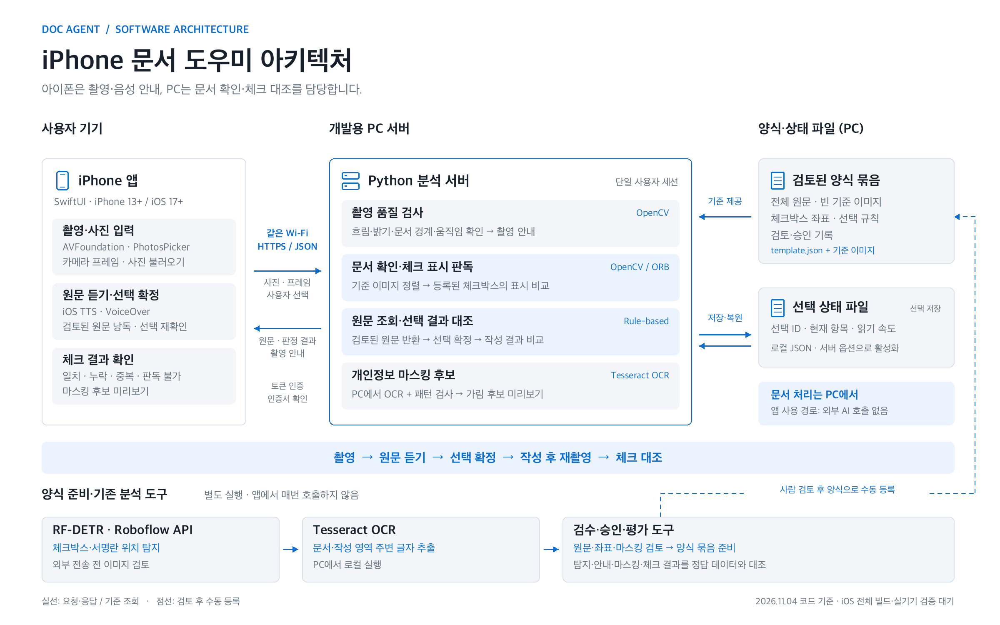

# Doc Agent 문서 촬영과 OCR

## 현재 iPhone 시연 경로

iPhone 후면 카메라 → 기기 내 문서 경계 검출·방향 안내·비프음 → 볼륨 위로 초점 → 렌즈와 선명도 확인 → 볼륨 아래로 직접 촬영 → 고해상도 사진의 Vision OCR → 원문 듣기. Vision은 해상도와 언어 보정 설정을 달리해 같은 줄의 글자를 대조한다. 글자가 없는 면은 밝기와 획 흔적을 확인해 반대쪽 확인 또는 재촬영을 안내한다.

OCR 완료 후 재검토할 줄이 있으면 iPhone이 같은 Wi-Fi의 Mac에 글자와 줄 위치를 보낸다. Mac은 OpenAI Responses API의 `gpt-5.6-luna`로 문맥을 검토한다. 서버에서 별도 줄의 실제 근거 구절을 확인한 뒤 iPhone이 OCR 점수와 문맥 점수를 합쳐 경고 여부를 정한다. 로컬 판독이 충돌한 줄에는 경고를 유지한다. 사용자는 Wi-Fi 연결을 복구한 뒤 검토를 다시 시도할 수 있다.

음성 질문은 iPhone의 Apple Speech가 기기 내에서 한국어로 받아쓴다. 사용자는 확인 안내를 듣고 질문을 수정하거나 다시 말할 수 있다. 확인한 질문, 현재 면의 OCR 줄, 최근 문답, 등록된 사례·용어가 같은 Wi-Fi의 Mac을 거쳐 GPT-5.6 Luna에 전달된다. 질문의 지시 대상이 모호할 때는 되묻고, 문서에 근거한 답은 인용된 줄과 함께 제공한다. 읽기 모드에서 사진과 질문 음성은 iPhone에 남는다. [iPhone과 중계 서버 실행 안내](../ios/README.md)

**작성 안내**는 기존 촬영 세션을 마친 뒤 아이폰 후면 카메라를 다시 연다. 같은 양식의 고정 문구와 공간 배치를 확인하거나, 일반 문서는 사진 한 장의 Gemini 전송에 동의를 받아 작성란 후보를 구한다. OpenCV가 현재 참조 사진과 실시간 프레임 사이의 변환을 구하고 Apple Vision이 검지 끝을 찾는다. 선택한 칸 도착과 실제 종이의 체크 상태는 각각 측정한다. [통합 경로와 검증 수치](ios-writing-demo-handoff.md)

## 노트북 시연 경로 (일반 OCR 모드)

`python -m docagent.home serve`는 등록 양식 없이 촬영한 생활 문서를 읽는다. [설치·사용 안내](home-document-assistant.md)를 따른다. 기존 아키텍처 이미지의 등록 양식 대조는 이전 구현이며 아래 표가 현재 노트북 흐름이다.

| 구성 | 맡는 일 |
|---|---|
| 브라우저 카메라 | 960px 안내 프레임 → 초점 확인 후 사용자가 최대 4000px 영상 프레임 촬영. 촬영 후에만 원문·질문·체크 상태 기능 노출 |
| macOS Vision `home/macos_ocr.py` · `home/capture.py` | 문서 영역 검출, 잘림, 꼭짓점 움직임 검사. 다른 OS는 OpenCV. 초점 요청 후에는 문서 내부의 선명도 확인 |
| Web Audio · 설치된 한국어 TTS | 시작 확인음, 상태별 비프음, 음성 중 감쇠. 안내 간격과 안정 시간을 적용 |
| `home/reader.py` · Apple Vision OCR | 촬영 원본의 한국어·영어 인식, 문서 밖 텍스트 제외, 불확실한 글자 표시, 서명 문구 위치·체크칸 후보 판독. 다른 OS는 Tesseract |
| 로컬 검색 · Ollama Qwen 3.5 4B | 현재 OCR 줄과 질문 맥락에서 근거 검색·선택. 서버가 선택된 OCR 구절만 읽고 근거가 없으면 찾지 못했다고 안내 |
| 브라우저 마이크 · faster-whisper small | 최대 30초 녹음 → 한국어 인식 → 사용자 확인 → 질문 |
| 로컬 메모리 | 현재 사진·OCR·최근 질문. 새 촬영이나 지우기로 초기화하며 기본 파일 저장 없음 |

촬영 전에는 경계와 안정성, 촬영 후에는 OCR을 처리한다. 정밀 문자 인식을 매 프레임 실행하지 않는다. 촬영 가능은 문서의 글자를 정확히 읽었다는 뜻이 아니다. 촬영 버튼은 문서 경계와 초점 확인 후 활성화된다. 사진 파일은 직접 불러올 수도 있다. OCR이 비거나 신뢰 가능한 글자 비율이 낮으면 재촬영을 안내한다. 한 줄만 잘 읽혔다고 전체 문서를 성공 처리하지 않는다. macOS의 OCR 입력은 원근 보정으로 작은 글자를 손상시키지 않도록 촬영 원본을 유지한다.

읽기 근거는 등록된 원문이 아니라 실제 촬영본의 OCR이다. 긴 문서는 로컬에서 관련 줄을 골라 제한된 문맥에 넣으며, 답이 없을 때 전체 문서에 정보가 없다고 단정하지 않는다. 별도 벡터 DB·Jev·외부 OCR API를 사용하지 않는다. 체크 상태는 사진에서 추정한 결과이고 사용자가 정한 선택과의 대조는 이번 기본 흐름에서 제외했다. 서명 위치는 OCR 문구의 대략적인 위치이며 펜 유도 기능은 아니다.

`--template`을 지정하는 기존 양식 모드와 `serve-mobile`은 별도로 유지한다. 아래 그림은 PC에 연결하던 이전 iPhone 앱의 설계 기록이다.

## 기존 iPhone 아키텍처 (2026-11-04)

아래 그림과 iPhone 설명은 2026년 11월 4일 `feature/home-document-assistant`의 코드 기준이다. **아이폰은 촬영·화면·음성 안내를 담당하고, 같은 Wi-Fi의 개발용 PC가 기존 Python 기능으로 문서를 분석한다.** `serve-mobile`은 기존 모바일 실행 경로로, 위 노트북 경로의 Ollama·마이크 질문·촬영본 OCR 원문 대조 조건은 연결되어 있지 않다.

[PNG 원본](architecture/software-architecture.png) · [편집 가능한 SVG](architecture/software-architecture.svg) · [설치·시연 안내](../ios/README.md)

## 그림을 읽는 방법

- **왼쪽 — iPhone 앱:** SwiftUI 화면에서 문서를 촬영하거나 사진을 불러오고, 원문과 확인 결과를 음성으로 듣는다. 지원 범위는 iPhone 13 이상·iOS 17 이상이다.
- **가운데 — PC 서버:** 사진의 품질과 양식을 확인하고, 체크 표시를 읽어 사용자가 확정한 선택과 비교한다. 네 개의 처리 상자는 각각 별도 서버가 아니라 **하나의 Python 프로그램 내부 기능**이다.
- **오른쪽 — PC 파일:** 검토된 양식의 원문·빈 기준 이미지·체크박스 좌표·선택 규칙을 읽는다. 이어하기를 켠 경우에만 선택 상태를 JSON 파일로 저장한다. 별도 데이터베이스는 없다.
- **아래 — 기존 분석·검수 도구:** RF-DETR 탐지와 OCR 결과를 사람이 검토해 양식을 준비하는 별도 경로다. 점선은 **검토 후 수동 등록**을 뜻한다.

## 실제 사용 흐름

1. **앱을 PC에 연결한다.** PC가 만든 연결 파일의 주소·인증서 지문·토큰을 앱에 입력한다. HTTPS로 통신하며 앱은 지정한 인증서를 확인하고, 서버는 접속 토큰을 확인한다.
2. **문서를 촬영한다.** 앱은 카메라 프레임을 약 1.2초 간격으로 PC에 보내 촬영 안내를 받는다. 사용자가 촬영 버튼을 누르면 해당 화면 프레임으로 문서를 분석한다. 저장된 사진을 불러오는 방법도 있다.
3. **양식을 확인하고 원문을 듣는다.** PC는 촬영본과 등록된 빈 기준 이미지를 정렬해 같은 양식인지 확인한다. 확인되면 미리 검토한 페이지·항목 원문을 반환하고, 아이폰의 TTS가 그대로 읽는다. OCR 결과를 새로 요약하거나 안내문을 생성하는 과정은 없다.
4. **사용자의 선택을 확정한다.** 앱에서 선택지를 고르고 재확인한 뒤 확정한다. PC 세션은 이 선택을 기억한다. 앱에서의 선택과 종이 위에 실제 표시한 결과는 별도로 관리한다.
5. **작성 후 재촬영해 대조한다.** OpenCV가 등록된 체크박스의 표시를 확인하고 확정한 선택과 비교한다. 일치·불일치·미표시·중복 표시·판독 불가를 안내한다. 새 사진이나 선택 변경이 생기면 이전 완료 판정을 폐기한다.

확인 결과는 JSON으로 앱에 돌아온다. 음성 파일을 PC에서 전송하는 구조가 아니라 **반환된 원문과 안내 문장을 아이폰에서 읽는 구조**다.

## 사용 기술과 역할

| 기술 | 현재 맡는 일 |
|---|---|
| SwiftUI | iPhone 화면, 선택 제안·확정, 결과 표시 |
| AVFoundation · PhotosPicker | 카메라 프레임 입력과 사진 불러오기 |
| AVSpeechSynthesizer · VoiceOver | 원문 낭독과 화면·상태 음성 안내 |
| URLSession · HTTPS | 아이폰과 PC 간 사진·선택·결과 통신, 인증서 지문 확인 |
| Python HTTP 서버 · TLS | 앱 요청 수신, 토큰 확인, 처리 기능 호출과 세션 관리 |
| OpenCV · ORB | 촬영 품질 확인, 기준 이미지 정렬, 체크 표시 판독 |
| Rule-based 로직 | 검토된 원문 조회, 선택 확정, 실제 표시와 대조, 불확실 처리 |
| Tesseract OCR · 개인정보 패턴 규칙 | PC에서 개인정보 마스킹 후보와 미리보기 생성 |
| RF-DETR · Roboflow API | 기존 별도 분석 경로에서 체크박스·서명란의 **위치** 탐지 |

**RF-DETR의 위치 탐지와 현재 앱의 체크 표시 판독은 다른 기능이다.** 앱은 검토해 등록한 좌표와 빈 기준 이미지를 사용하므로 사진을 올릴 때마다 Roboflow를 호출하지 않는다. 체크 여부를 위한 새로운 분류 모델을 학습한 것도 아니다.

## 양식과 개인정보 처리

양식 묶음에는 공통 인쇄 원문, 빈 기준 이미지, 항목별 좌표·선택 규칙, 검토·승인 기록이 들어간다. 기존 탐지·OCR 도구로 확보한 자료를 사람이 확인해 이 형식으로 등록한다. 분석 결과를 자동 승인하거나 임의의 문서를 곧바로 지원 양식으로 만드는 기능은 없다.

사진과 프레임은 **마스킹 전 상태로 지정한 PC에 전송**된다. 마스킹 후보는 그 뒤 PC의 로컬 OCR과 패턴 규칙으로 만든다. 후보가 보인다고 모든 개인정보를 가렸다는 뜻은 아니다. 현재 앱 사용 경로에서는 Roboflow나 생성형 AI 서비스를 호출하지 않는다.

앱은 연결 정보와 문서 사진을 영구 저장하지 않으며, PC도 촬영 원본을 앱 저장 파일에 쓰지 않는다. 다만 OCR 실행 과정에서 OS 임시 파일은 사용될 수 있다. 선택 상태는 서버의 `--session` 옵션을 켠 경우에만 파일로 남는다. 네트워크 단절·앱 강제 종료 시 PC 메모리에 있는 사진은 서버 종료나 다음 초기화까지 남을 수 있다.

## 구현 범위와 검증 상태

앱 화면·PC HTTPS 연결 코드를 구현했으며 Python 회귀 테스트 1,836개, Swift 연결 설정·응답 계약 검사 16건, 실제 로컬 HTTPS를 통한 합성 문서 흐름을 확인했다. 기존 PC 웹 화면도 별도 실행 경로로 유지된다.

**Xcode가 없어 iOS 앱 전체 빌드·시뮬레이터·실제 아이폰 촬영과 VoiceOver 검증은 아직 하지 못했다.** 현재 양식은 합성 동의서 데모이며 실제 지원 동의서 선정, 원문·좌표 검토, 촬영 데이터 정확도 평가와 사용자 검증이 남아 있다.

이 기존 iPhone 경로에는 Jev·LLM 질문·벡터 RAG·마이크 질문·하드웨어 제어가 연결되어 있지 않다. 새 노트북 경로에는 위에서 설명한 로컬 Ollama와 Whisper가 연결된다. 두 경로 모두 한 사용자의 개발 시연용이며 여러 사용자의 세션을 분리하는 배포 서버는 아니다.

## 코드에서 찾아볼 위치

| 구성 요소 | 파일 |
|---|---|
| iPhone 화면 | [`DocAgentApp.swift`](../ios/DocAgentApp/DocAgentApp.swift) |
| 카메라 입력 | [`CameraView.swift`](../ios/DocAgentApp/CameraView.swift) |
| 앱 작업 흐름·TTS | [`HomeModel.swift`](../ios/DocAgentApp/HomeModel.swift) |
| HTTPS 통신·인증서 확인 | [`Connection.swift`](../ios/DocAgentCore/Sources/DocAgentCore/Connection.swift) |
| PC HTTPS 실행·연결 정보 | [`home/mobile.py`](../src/docagent/home/mobile.py) |
| 요청 처리·기능 연결 | [`home/server.py`](../src/docagent/home/server.py) |
| 촬영 품질 안내 | [`home/capture.py`](../src/docagent/home/capture.py) |
| 노트북 카메라·마이크·화면 | [`home/assets/app.js`](../src/docagent/home/assets/app.js) |
| 비프음·로컬 음성 제어 | [`home/assets/audio.js`](../src/docagent/home/assets/audio.js) |
| 촬영본 OCR·등록 원문 대조 | [`home/content_check.py`](../src/docagent/home/content_check.py) |
| 서명란·원문 근거 구성 | [`home/document.py`](../src/docagent/home/document.py) |
| 로컬 질문·음성 인식 | [`home/questions.py`](../src/docagent/home/questions.py), [`home/speech.py`](../src/docagent/home/speech.py) |
| 양식 정렬·체크 판독 | [`vision/checkbox_review.py`](../src/docagent/vision/checkbox_review.py) |
| 양식·원문·선택 관리 | [`home/templates.py`](../src/docagent/home/templates.py), [`home/session.py`](../src/docagent/home/session.py) |
| 마스킹 후보 | [`home/privacy.py`](../src/docagent/home/privacy.py) |
| 기존 RF-DETR 연결 | [`detector/roboflow_detector.py`](../src/docagent/detector/roboflow_detector.py) |
