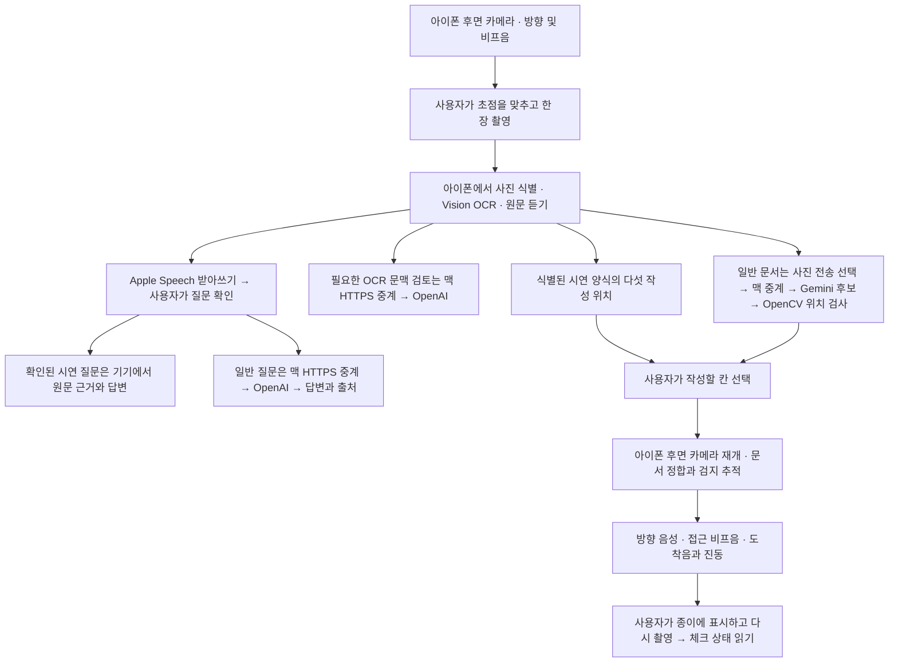

# 시각장애인을 위한 문서 도우미

**발표자 전달본 · 2026년 11월 22일 · iPhone 13 통합 버전**

> “내 정보를 누구에게 제공하는지 먼저 듣고, 내가 선택한 칸에 직접 표시하고 싶다.” 이 앱에서는 사용자가 종이 한 장을 촬영해 원문을 듣고 질문한 뒤, 같은 종이의 체크박스나 서명 공간까지 자기 검지를 안내받는다. 체크하고 다시 찍으면 실제 종이에 남은 표시도 확인할 수 있다.

시연 문서는 직업훈련생계비 대부 신청에 쓰이는 **「개인정보의 수집·이용·제공 동의서」**다. 제공받은 사진 `IMG_2510.heic`는 붙임3, 별지 제3호서식, 2024년 1월 1일 개정본이다. 첫 번째 줄에는 **수집·이용 동의 / 거절**, 두 번째 줄에는 **제3자 제공 동의 / 거절**이 있다. 다섯 번째 목표는 하단 **‘서명 또는 인’ 문구 바로 위에 실제로 쓸 수 있는 공간**이다.

## 발표에서 인용할 세 가지 결과

| 질문 | 결과 | 측정한 대상 |
|---|---|---|
| 시연 양식의 인쇄 문구를 더 정확히 읽었나? | 표본 문자 오류율 **8.27% → 3.18%**, **5.09%p 감소** | 같은 원본에서 만든 8장, 사람이 확인한 고정 인쇄문 13줄씩. 일반 OCR과 시연 양식 보정 후 표시 문구 비교 |
| 다시 찍은 사진에서 올바른 칸을 가리켰나? | 양식 식별에 성공한 7장에서 **체크박스 28/28개, 서명 공간 7/7개**에 추정 중심이 들어갔다. | 사진마다 다섯 위치를 주석과 비교. 흐린 1장은 양식 식별 단계에서 일반 OCR로 전환 |
| 옆 칸에서 잘못 도착했다고 알렸나? | 선택한 칸에서 **35/35회 도착**, 다른 칸에서 **0/140회 오도착** | 실제 문서 정합 코드에 10Hz 모의 검지 좌표를 넣은 맥 재생 시험. 사람과 아이폰 카메라로 측정한 도달률은 후속 과제 |

통합 앱은 **아이폰 13에 서명 설치하고 프로세스 실행까지 확인**했다. 아래 성능 수치는 Apple M4 맥에서 기록했다. 아이폰의 설치·실행 확인과 실제 사용자의 독립 작성 성공률은 각각 다른 검증 단계다.

## 아키텍처와 데이터 흐름

| 실행 위치 | 맡은 일 | 필요한 데이터 |
|---|---|---|
| 아이폰 | 촬영, 한국어 OCR, 원문 낭독, 질문 받아쓰기·확인, 시연 양식 읽기, 실시간 손 안내, 체크 상태 판독 | 촬영 사진, 현재 카메라 프레임, 마이크 음성. 실시간 손 영상과 질문 음성은 폰에서 처리한다. |
| 같은 Wi-Fi의 맥 | 아이폰의 HTTPS 요청을 받고 API 키를 사용해 외부 모델을 호출한다. 일반 서식의 후보 영역은 OpenCV로 정밀화한다. | 질문·OCR 검토용 텍스트, 또는 사용자가 작성란 분석을 선택한 사진 한 장 |
| OpenAI | 현재 문서 질문·후속 질문에 답하고, 판독이 약한 줄의 원문 근거를 검토한다. | 질문 경로에서는 OCR 줄과 위치, 관련 줄 번호, 최근 최대 8회 문답, 등록 사례·용어를 받는다. |
| Gemini | 일반 문서 사진에서 체크박스·서명란·입력란 후보를 제안한다. | 사용자가 전송을 선택한 정지 사진. 손가락을 움직일 때마다 호출할 필요는 없다. |

맥 중계는 질문을 `/v1/answer`, OCR 검토를 `/v1/review`, 일반 문서 작성란 탐지를 `/v1/fields`로 받는다. 프로젝트의 기본 모델 설정값은 OpenAI `gpt-5.6-luna`와 Gemini `gemini-4-hydrogen`이다. 이번 통합 시험에서 두 API의 실제 호출은 각각 0건이므로, 라이브 모델의 응답 품질과 대기시간은 시연 계정으로 따로 확인해야 한다.

### 문제를 보고 바꾼 구현

**1. 종이 왼쪽이 잘렸는데도 촬영 준비가 되는 문제.** 실제 제보 사진에서 이전 검출기는 화면 왼쪽 경계에서 폭의 약 0.69% 안쪽에 가짜 종이 변을 잡았다. 네 모서리 후보와 그 바깥의 배경 여백을 함께 확인하도록 바꿨다. 같은 입력에서 ‘왼쪽 잘림’으로 판정해 초점을 잠갔다. 사용자는 이동 방향을 음성으로 듣고, 움직임이 개선되면 빨라지는 비프음으로 결과를 확인한다. 네 모서리가 안정되면 긴 확인음이 울리고, 사용자가 초점과 촬영을 차례로 누른다. 화면 버튼과 볼륨 위·아래 버튼을 지원한다.

**2. 제대로 읽은 줄에도 ‘인식 불확실’이 반복되는 문제.** 일반 사진은 Vision OCR을 서로 다른 설정으로 읽어 같은 위치의 문구를 대조한다. 두 판독이 충돌하면 경고를 유지한다. 충돌이 없고 기기 점수가 0.70 이상이면 바로 읽는다. 기기 점수가 낮아도 OpenAI가 다른 원문 줄에서 뒷받침하는 인용을 제시하고, 문맥 점수와 가중 점수(기기 70% + 문맥 30%)가 모두 0.60 이상이면 경고를 생략한다. 이 숫자는 경고를 제어하는 설정값이다. 첫 표의 문자 오류율 개선은 **시연 양식의 고정 인쇄문 대조**에서 측정했다. OpenAI 문맥 검토의 개선 폭은 별도로 측정해야 한다.

**3. 짧은 질문과 후속 질문에서 맥락을 놓치는 문제.** “이거 어떤 서류야?”는 문서 전체를 가리키고, “그럼 누구에게 줘?”는 직전 답에 기대는 질문이다. 앱은 한국어 음성을 기기에서 받아쓰고 사용자가 들은 뒤 전송을 확인하게 한다. 일반 질문은 여러 표현으로 관련 단락·표 칸과 앞뒤 최대 3줄을 찾는다. 현재 페이지 원문도 함께 보내 제목·표·앞선 답을 참조할 수 있게 했다. 앱에서 원문과 사례 출처를 구분하며, 범위가 모호하면 되묻고 근거가 부족하면 그 사실을 알리도록 구성했다.

**4. 손이 종이를 가리고 휴대폰 각도가 바뀌는 문제.** 첫 촬영에서는 종이 전체가 들어왔는지가 중요하다. 작성할 때는 종이 일부가 가려져도 사용자가 고른 작은 칸을 따라가야 한다. 두 단계의 카메라 판정을 따로 두고, 같은 참조 사진과 목표 좌표로 연결했다. 팀원 코드의 ORB로 인쇄물 특징점을 찾고, Hamming 거리로 같은 특징을 연결한 뒤 RANSAC으로 원근 변환을 추정한다. 이 변환으로 현재 프레임과 참조 사진의 좌표를 맞춘다. 노트북 카메라와 MediaPipe가 하던 손 입력은 아이폰 후면 카메라와 Apple Vision의 검지 끝 좌표로 연결했다.

**5. 옆 칸에서 도착음이 나거나 빈칸을 ‘동의’로 읽는 문제.** 도착에는 안정된 연속 프레임, 화면 안에 들어온 목표의 네 꼭짓점, 한 손의 검지 검출 점수 0.55 이상이 필요하다. 검지 끝이 선택한 칸 안에 있고 다른 칸과 겹치지 않는 상태가 **0.65초** 이어져야 도착을 알린다. 손이나 문서를 놓치면 대기 시간을 초기화한다. 종이에 무엇을 썼는지는 손을 치우고 새로 찍은 사진에서 판정한다. 체크 테두리가 확인되면 안쪽 잉크 비율 6.2% 이상은 ‘표시’, 1.5% 이하는 ‘빈칸’, 중간값은 ‘확인 어려움’으로 읽는다. 서명란에서 앱이 알려주는 것은 **서명할 위치**다.

### 시연 캐시는 언제 열리는가

- **동일 파일을 불러오면** 바이트 수와 SHA-256 지문이 각각 등록값과 일치할 때 검수한 고정 인쇄문 46줄을 사용한다.
- **실물 종이를 다시 찍으면** OCR을 실행한다. 서식 번호·개정일, 여러 위치의 본문, 작성 줄 주변 문구와 배치가 일치해야 고정 문구와 다섯 좌표를 적용한다. 조건이 부족하면 촬영본의 일반 OCR 결과를 제공한다. 체크 상태는 매번 그 사진의 픽셀을 읽는다.
- **시연 질문을 하면** 서류 설명·요약, 제3자 제공 기관, 동의 거부 결과라는 세 주제의 등록 표현과 해당 원문 줄을 함께 확인한다. 후속·복합 질문은 일반 질의 경로로 보낸다. 일반 문서의 작성란 분석 결과도 동일한 JPEG에서만 재사용한다.
- **같은 질문을 반복하면** 문서 원문·질문·최근 대화 등 요청 내용이 일치할 때 현재 문서에서 받은 답을 다시 쓸 수 있다. 문서를 바꾸면 이전 문서의 대화 캐시를 비운다.

## 검증 결과와 측정 조건

2026년 11월 22일 통합 검증은 빈 동의서 원본 한 장에서 만든 변형, 다른 문서, 팀원의 저장 응답을 사용했다. CER는 삽입·삭제·교체 글자 수를 정답 글자 수로 나눈 값이다. 중앙값은 관측값 가운데 값이고 p95는 95백분위다. 아래 픽셀 오차는 각 시험의 이미지 해상도를 기준으로 한다.

| 항목 | 시험 방법 | 결과 |
|---|---|---|
| 촬영 중 잘림 | 이전 촬영 회귀에서 실제 제보 캡처, 방향 변형, 정상·빈 종이 등 입력 11개를 맥에서 재생 | **11/11** 예상 상태. 같은 캡처에서 파생된 입력 포함 |
| 양식 캐시 적용 | 원본 디코딩·원근·그림자 등 같은 양식 8장, 개정·기간 변경·다른 서식 등 적용 금지 입력 8장 | 같은 양식 **7/8** 허용, 적용 금지 입력 **0/8** 오적용. 흐린 원근 변형 1장은 일반 OCR 사용 |
| OCR 문자 및 핵심 문구 | 공백·문장부호 제외 307자 × 8장. 캐시를 적용하지 못한 사진도 포함. 핵심 문구 별도 6개 × 8장 | 글자 오류 **203/2,456 → 78/2,456**. 핵심 문구 일치 **41/48 → 46/48** |
| 사진에서 작성 위치 찾기 | 양식 식별에 성공한 7장에서 사람이 지정한 체크박스 4곳과 서명 공간 1곳 비교 | 중심이 올바른 영역에 포함 **35/35**. 중심 오차 중앙값 **1.70px**, p95 **3.35px**. 원본 디코딩본 2344×3156, 나머지 1340×1800 |
| 작성 중 카메라가 움직일 때 | 720×960 프레임. 같은 종이의 회전·원근·가림 등 8장과 반전·다른 문서 등 7장에 실제 정합 코드 실행 | 추적할 프레임 **8/8** 정합, 거부할 프레임 **7/7** 거부. 성공 프레임의 40개 좌표 오차 중앙값 **0.50px**, p95 **1.01px** |
| 선택한 칸으로 손끝 안내 | 카메라 조건 7가지 × 목표 5곳. 모의 손끝을 목표 및 다른 네 칸에 배치 | 올바른 도착 **35/35**, 다른 칸 **0/140** 오도착. 손 소실·문서 소실 각각 **0/35** 오도착. 복귀 뒤 **35/35** 재도착 |
| 체크 흔적 재판독 | 빈 실물 사진의 네 칸에 한 종류의 체크 획으로 가능한 16가지 조합 합성 | 표시 **32/32**, 빈칸 **32/32**, 보류 **0/64**. 실제 연필·펜·필체별 정확도는 추가 측정 대상 |
| 문서 질문 분기 | 등록 질문 표현 4개와 후속·근거 부족·방금 한 체크·복합 질문 4개 | 준비한 표현 **4/4** 출처 포함 응답. 나머지 **4/4**는 일반 경로로 전달. 이 시험의 라이브 OpenAI 호출 **0건** |
| 통합 회귀와 실기기 | 11월 22일 회귀 기록 및 이후 서명 설치·실행 기록 | **Swift 46개, Python 1,929개 통과**. 후속 작업에서 **아이폰 13 설치·실행 확인**. 음성 전사 오류율, 실제 손으로 작성한 성공률, VoiceOver 독립 수행 시간은 미측정 |

### 일반 문서에서는 어디까지 안내했나

일반 문서 사진 **4장**에 대해 팀원이 저장한 Gemini 후보 **101개**를 재생했다. OpenCV의 테두리·빈 공간·겹침 검사를 통과한 영역은 **76개**였다. 이 76개는 후처리에 남은 후보 수다. 사람의 승인점과 대조할 수 있는 사진은 그중 **1장**이었다.

| 한 장에서 대조한 작성란 | 사람의 승인점 | 대응하는 영역을 반환 | 그 영역 안에 승인점 포함 |
|---|---:|---:|---:|
| 체크박스 | 3 | 3 | **3/3** |
| 서명란 | 2 | 1 | **1/2** |
| 일반 입력란 | 11 | 4 | **2/11** |

이 표에서 가장 큰 개선 대상은 일반 입력란이다. 11곳 중 7곳에는 대응 영역이 없었고, 영역을 반환한 4곳 중 2곳은 승인점을 포함하지 못했다. 다음 주석 작업에서는 인쇄된 ‘서명’ 글자와 실제로 손이나 펜을 놓을 빈 공간을 따로 표시해야 한다.

### 처리 시간

| 구간 | 측정값 | 측정 범위 |
|---|---:|---|
| 등록된 동일 HEIC의 원문 찾기 | 중앙값 **0.51ms** | 맥 10회, 파일을 메모리에 읽은 이후 지문 확인·조회 |
| 재촬영을 모사한 사진 읽기 | OCR 중앙값 **798ms**, OCR과 양식 대조 전체 **946ms** | 양성 사진 8장, 맥. 두 값은 각각 계산한 중앙값 |
| 일반 문서 작성란 분석 | 첫 로컬 처리 **785.45ms** → 동일 JPEG 재요청 **1.85ms** | 사진 4장 중앙값. 저장된 Gemini 응답 재생. 팀원의 과거 실제 API 요청 4건은 **18.648~123.131초** |
| 작성 중 문서 위치 정합 | 중앙값 **28.68ms**, p95 **95.34ms** | 맥에서 성공·거부를 포함한 독립 프레임 15개. 손 검출·낭독 제외 |
| 선택한 칸 진입 후 도착 안내 | **700ms** | 10Hz 모의 좌표 샘플링에서 0.65초 유지 조건이 처음 충족된 시점. 사람이 칸을 찾는 시간은 별도 |

## 7분 시연 순서

| 시간 | 발표자가 할 일 | 관객이 확인할 점 |
|---|---|---|
| 0–1분 | 동의서 왼쪽을 일부러 자른 뒤 음성을 따라 휴대폰을 옮긴다. 안내가 바뀌면 초점을 잡고 직접 촬영한다. | 방향을 듣고 올바르게 움직이면 비프음이 빨라진다. |
| 1–2분 | **전체 원문 듣기 → 문서에 질문하기**에서 “내 정보는 누구에게 제공돼?”라고 말한다. 받아쓴 질문을 듣고 전송한다. | 출처 줄과 함께 답한다. 이 질문은 식별된 시연 양식에서 준비한 경로라고 밝힌다. |
| 2–4분 | **체크·서명 안내 → 개인정보 제3자 제공에 동의하지 않음**을 선택한다. 같은 줄의 왼쪽 칸에서 시작해 오른쪽 칸으로 검지를 옮긴다. | 반대 선택지에서는 방향을 안내하고, 선택한 칸에서 검지를 멈추면 도착음이 난다. |
| 4–5분 | **다른 칸 선택 → 신청인 서명 또는 인**을 누른다. 종이와 검지가 함께 보이게 하고 안내를 따른다. | ‘서명 또는 인’ 위 빈 공간을 찾는다. |
| 5–6분 | 실제 종이에 표시하고 손을 치운 뒤 **작성 후 새로 촬영**한다. 작성 안내를 열어 체크 상태를 듣는다. | 방금 표시한 칸과 옆의 빈칸을 각각 읽는다. |
| 6–7분 | 다른 서식을 불러와 일반 문서 경로를 보여준다. 라이브 질의·작성란 분석을 시연할 때는 같은 Wi-Fi의 맥 중계와 해당 API 계정을 미리 확인한다. | 시연 양식의 원문·고정 좌표가 다른 서류에 적용되는지 직접 구별할 수 있다. |

## 질의응답과 다음 검증

**“왜 모델 하나에 사진이나 영상을 전부 맡기지 않았나요?”** 이전 Qwen 실험에서는 체크칸 확대본의 빈칸 6개를 모두 ‘표시 있음’으로 읽었다. 현재 모델은 문구 해석이나 후보 생성에 쓰고, 어느 칸에 도착했는지와 표시가 남았는지는 좌표와 픽셀로 판정한다. 첫 촬영과 작성 중 추적을 따로 구현한 이유도 같다. 종이 전체가 보여야 하는 시점과 손이 일부를 가린 채 같은 문서를 따라가야 하는 시점이 다르다.

**“시각장애인도 혼자 작성할 수 있다고 검증했나요?”** 아이폰에서 통합 앱이 실행되는 것과 맥 재생 시험의 도착 판정까지 확인했다. 다음 실기기 평가에서는 VoiceOver를 켜고 ‘제3자 제공 거절’과 ‘서명 위치 찾기’를 각각 수행한다. 외부 도움 없이 올바른 칸에 표시한 횟수/전체 시도, 반대 동의칸에 표시한 횟수, 목표 선택부터 실제 도달까지 걸린 시간, 추적 소실 후 복귀 시간을 기록한다. 참여자·문서·조명별로 나눠 같은 원본에 반복 성공한 결과와 비교할 수 있게 한다.

**“무엇부터 개선하나요?”** 먼저 미검출이 많았던 일반 입력란과 서명 공간에 새 정답 주석을 확보한다. 다음으로 같은 질문·녹음에서 한국어 전사 문자 오류율과 원문 근거가 맞는 응답 수/전체 질문 수를 따로 잰다. OpenAI와 Gemini의 역할을 한 모델로 합치는 선택은 같은 입력에서의 작성란별 승인점 포함률, 근거 일치율, 첫 답변 대기시간, 문서당 비용을 함께 비교해 결정할 수 있다.

### 수치와 코드를 다시 찾을 때

아래 경로는 프로젝트 저장소 기준이다. 위 결과표와 구조도는 이 파일 하나로 읽을 수 있다.

| 찾아볼 내용 | 원자료 또는 구현 |
|---|---|
| 11월 22일 입력별 정답·오차·시간·테스트 건수 | `docs/validation/writing-demo-2026-11-22.json` |
| 왼쪽 잘림 회귀와 과거 Qwen 판독 실험 | `docs/ios-document-consent-retrospective.md` |
| 촬영 판단, OCR 경고, 질문 문맥 구성 | `ios/DocAgentCore/Sources/DocAgentCore/`의 `ManualCapture.swift`, `PhotoReader.swift`, `PageRetrieval.swift`, `CloudQuestion.swift` |
| 양식 식별, 작성란, 손끝 도착 | 같은 경로의 `DemoConsentForm.swift`, `CheckboxInspection.swift`, `WritingGuidance.swift` 및 `ios/DocAgentCore/Sources/WritingVision/WritingVision.cpp` |
| 맥 중계, 일반 서식 검사, 손끝 재생 시험 | `src/docagent/cloud_relay.py`, `src/docagent/writing_fields.py`, `ios/DocAgentCore/Tests/DocAgentCoreTests/WritingEndToEndReplayTests.swift` |
